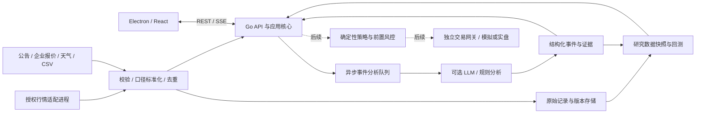

# 玉米期货事件监控与量化研究系统方案

版本：初始实施方案，已按 MVP 代码复核；资料核验日期：2026-10-27，实施复核日期：2026-10-28。相关来源与许可证核验见 [research.md](research.md)。下文明确区分本轮 MVP 范围与未来目标；运行验证情况以 README 和测试记录为准。示例数据用于演示链路，不代表当前市场。

## 1. 要解决的问题

用户需要持续理解玉米期货及产业链的变化，并检验某条信息是否对后续价格有稳定解释力。产品必须能回答：最新信息是什么、原始证据在哪里、何时才可被策略知道、影响哪个地区/环节/合约、与哪项历史口径可比较、策略为何交易或不交易、成本和市场限制是否使回测失真。

范围从玉米 `C` 起步，关联 `CS`、`LH`、`M`，后续增加小麦替代、港口/进口、能源与海外因素。`c2701` 是用户给定的初始观察合约，生产主力由有时间戳的行情与显式规则决定。本轮 CSV 和回测仅接受玉米实际合约的日线；关联品种只有明确标识的演示行情及手动/Feed 产业信息入口，尚无关联期货实时接入。事件和基本面并非天然适合高频交易。

## 2. 技术决策及其原因

| 层 | 本轮选择 | 后续扩展 | 原因与限制 |
| --- | --- | --- | --- |
| 桌面 | Electron + React + TypeScript | Windows/macOS/Linux 按目标平台打包签名 | 满足本地桌面要求，UI 与服务分离，允许云化后保留同一客户端。 |
| 常驻服务 | Go，REST 命令/查询和 SSE 状态推送 | 内部协议可扩为 gRPC/Protobuf；高吞吐流按实测演进 | 编译部署简单，并发采集和网络服务适合。Go 有 GC、操作系统有调度，不能承诺硬实时或亚毫秒成交。 |
| 数据持久化 | bbolt 单机事务数据库，分开演示/导入行情，保存事件、观察、分析历史和研究记录 | 关系查询需求增加后评估 SQLite；Parquet + DuckDB 管历史；云上 PostgreSQL + 对象存储 | 本轮已采用 bbolt，未实现 SQLite/Parquet。单文件数据库不作为多实例网络共享写入方案。 |
| 研究 | Go 有限范围基准回测 | Python + Polars/pandas/NumPy，成熟引擎做交叉验证 | 先建立可审计账本；Python 便于研究，重计算不阻塞核心服务。 |
| 市场适配 | CSV/手动事件与观察、可配置 RSS/Atom、手动/可选定时天气采集，明确演示模式 | Python TqSdk 或 vn.py CTP 独立进程；必要时 C++/Rust 执行组件 | RSS/Atom 需要自行配置授权源；天气使用 Open-Meteo 非商业评估端点。本轮无真实期货行情网关。 |
| LLM | 可配置的兼容接口，后端保存凭据；可无模型运行 | 本地推理或企业网关，严格结构化输出和评测 | 模型可替换。LLM 耗时、失败与不确定性不进入交易热路径。 |

若以后采用 SQLite，WAL 允许读写并发但仍只有一个写入者，并要求同主机共享相关文件；因此不能把数据库放在网络盘上供多个云实例写。[SQLite WAL 文档](https://www.sqlite.org/wal.html)。性能用 CPU、分配、trace 和 pprof 诊断，依据实际负载选择优化，而非根据语言名判断。[Go 诊断文档](https://go.dev/doc/diagnostics)。

## 3. 组件和数据流

目标核心负责规范数据、确定时间顺序、持久化、主力观察、研究任务和界面推送。本轮采集有同类任务互斥、LLM 和回测有并发上限；SSE 是有界缓冲的状态失效通知，慢消费者可丢掉重复通知，客户端应重新拉取快照。它不是可靠消息队列或 tick 行情总线。持久队列、消费确认、积压告警与重放属于后续能力；未来行情热路径独立于全文检索、LLM 和回测。

MVP 使用单个 Go 进程和本地 bbolt；架构图中的持久原文仓库、异步持久队列及“后续”连线是目标结构，不能据图推断已实现账户和下单能力。当前 Feed 保存解析后的标题/正文与来源链接，没有归档完整 HTTP/XML 原始字节；当前回测没有消费事件因子。未来扩到分布式时再引入消息队列。

## 4. 数据契约

### 4.1 统一元信息（目标规范）

所有记录保存：`id`、来源/原始链接、原始文本或文件哈希、数据类型、合约或商品、区域、`event_time`、`published_at`、`received_at`、`available_at`、时区、版本、质量状态。`available_at` 是该记录在策略中允许可见的时间，不得根据最终修订数据倒推。

实际采集时，原始记录的 `available_at >= received_at`；模型衍生结果还须 `available_at >= analyzed_at`。历史导入采用可信首次发布时间加已声明的供应商/处理延迟；缺少这些证据的数据标记 `historical_exploratory`，不能伪装成生产时点数据。统一存 UTC 时间，桌面显示 `Asia/Shanghai`，另存交易所 `trading_day`。

数据库采用“事实的有效时间 + 系统知道该事实的时间”双时间思路。修订生成新版本、关联原版本，保留更正理由。重复转载归入同一事件簇，但不删除来源证据；单一来源的 10 次转载不计为 10 个独立确认。

### 4.2 行情与规则

行情至少含交易所、合约、交易日、周期、开高低收、成交量、持仓量、来源；交易研究还需要结算价、前结算、涨跌停价、合约乘数/最小跳动、有效费用表与保证金表。生产价格采用整数 tick/定点数，金额明确舍入规则，避免二进制浮点误差进入账本。

合约规格和参数按生效日期存版本，不能对整个历史套用今天的手续费、保证金或涨跌停。成交量单双边、累计/增量、时标代表区间开头还是结尾，需要适配器明确声明。负价格、重复时标、OHLC 不一致、非单调时间、缺失和异常跳变进入隔离队列；可疑数据不能静默修成看似连续的市场。

### 4.3 产业指标

| 指标 | 关键字段 | 建议比较方式 |
| --- | --- | --- |
| 收购/到厂报价 | 企业、地点、产年、等级、水分、税运、原单位、有效时间、价格类型 | 同企业同口径变动；异质样本分组展示 |
| 到车量 | 统计企业集、观测截点、排队/到达/卸车定义、车次、估算吨数依据 | 同样本同截点对比、节日/星期调整；样本变更单独标记 |
| 天气 | 产区、经纬度、预报批次、有效时间、温度/降水/土壤湿度、作物阶段 | 产量/面积加权异常、预报修正幅度；生长季与收获季分模型 |
| 港口/库存 | 港口/企业集、品级、调查方法、库存/出入库、统计窗口 | 可比样本下周环比、季节分位数 |
| 关联价格 | 品种、现货/期货、合约、时间、单位、有效规格 | 收益率、同月份价差、加工毛利模型；不以原价直接相减混淆单位 |

“玉米淀粉价差”不是完整加工利润：需考虑产出率、副产品、能源、加工和物流成本。“生猪价格上涨”也不必然意味着当期饲料需求上涨，应与存栏/出栏、养殖利润共同研究。

## 5. 主力合约与交易日

### 5.1 观察主力和可交易合约分开

本轮提供可重放的研究主力选择：初次选择要求至少两个可比合约、同一量仓领先者在连续两个有数据日期确认；换月要求远月成交量和持仓量均高于原合约 10%，持续两个有数据日期，只向远月切换并排除交割月。阈值和两日确认目前固定于实现，尚无完整交易所日历来证明相邻“有数据日期”就是相邻交易日；单合约 CSV 不足以确认主力。输出包含最新可用数据日期和沿用历史结果的说明，不能称为官方实时主力。

目标生产规则需要研究持仓优先、量仓双领先等方案，并将比例、确认日数和最短持有天数版本化、配置化。每日收盘后确认的结果最早随后交易时段生效；缺失日和流动性门槛必须显式处理。上述规则属于系统研究约定，不是交易所定义。

每次决定落盘 `selected_at / effective_at / previous / next / evidence / rule_version`。候选数据不足或过期时保留最后确认结果并标记 stale，不能按月份自动猜测。未来回测必须重放当时的候选集合与规则；当日收盘后产生的排序不得用于当天早盘交易。

主力切换改变观察对象，不自动移动持仓。策略换月需执行旧合约平仓和新合约建仓，记录两腿成交、费用、滑点和未完成敞口。研究可保存未复权/前复权/后复权连续序列用于可视化或信号比较，但账本始终使用真实单合约价格；不同复权方法的信号敏感性要检验。

### 5.2 交易日历是数据

不能简单把自然日加一天作为夜盘交易日，也不能用“周一至周五”覆盖法定节假日、临时停盘和节前无夜盘。优先使用行情源提供的交易日并校验已发布交易所日历，维护按品种生效的交易时段。周五夜间时段的交易日归属、长假前后、停夜盘恢复、不同品种不同夜盘时段都需要专门测试。

日历覆盖范围外标记未知并停止自动下单；仅支持基础交易日字段的 MVP 不宣称已覆盖未来全量假日日历。生猪等关联品种不能机械复用玉米的时段。

## 6. 事件分析与大模型

流程：原文/附件入库 → 单位/时间/实体预解析 → 去重 → 规则分类 → 可选 LLM 结构化抽取 → 模式校验/证据校验 → 事件版本 → 规则告警/人工核验。对于重要报价、政策和灾害，展示可点击原始来源及证据片段。

目标输出包括事件类型、商品、地区/企业、发生及发布时间、数值及原单位、变动与比较基准、影响期限、影响机制、方向（支持“混合/未知”）、置信度、证据片段和待核验项。原文没有数值时不得编造数字；模型摘要与已核验事实在 UI 上分开。没有模型配置时可使用明确标识的规则分析，不称为“大模型已分析”。

原文视为不可信数据，网页中的“忽略指令”“上传密钥”不能变成系统操作。分析器没有下单、Shell、凭据查询权限；API 密钥不进入渲染层、日志、导出文件或提示词。生产版本应限制请求体/输出大小、超时、重试、并发、费用上限和允许的模型服务地址；失败保留原始事件，不阻断行情。

历史模型结果保存模型名/版本、提示词版本、参数、输入哈希和输出，缓存相同输入避免重复消耗。构建人工标注集，分别评估实体、数值、单位、时间、方向、证据覆盖和拒绝无证据结论能力；以字段准确率和关键错误率衡量，不能只看自然语言是否顺畅。

## 7. 回测与量化体系

### 7.1 本轮研究基线

当前实现限定为单个玉米合约的日线双均线趋势策略：收盘产生目标仓位，下一根日线开盘按观察价格尝试成交；手续费按手/边计，滑点按整数 tick 折成独立现金成本，保证金率与费用为固定研究参数。支持量不足/方向性涨跌停拒绝、开收盘风险检查和期末计划平仓，未成交则保留持仓和浮动盈亏。示例策略用于测试链路，不代表有盈利能力。严格检查输入数据与参数，拒绝把多个不同合约直接当一条价格序列回测。

**当前重要限制：**日末 `volume` 被用于事后成交可行性过滤和全日成交量上限，它在开盘时尚不可知；因此仅“策略信号使用上一根已结束 bar”，不能宣称整个撮合完全没有前视假设。`settlement` 当前用于输入校验，净值仍按收盘价估值，未模拟结算价逐日结算或资金划转；没有 tick/夜盘路径、盘口排队、历史变动费用、完整交易所假日日历、真正多合约换月、事件因子、组合和 walk-forward 引擎。成交记录的 timestamp 是所属日K结束时间，具体开盘/期末收盘含义在 reason 字段说明。生产研究必须进入下一阶段补齐这些差距。

当前输出包含配置、交易记录、权益曲线、收益/最大回撤/往返交易数/胜率、手续费/滑点和限制说明；导出含输入SHA-256、引擎版本和样本数量，回测旁另存审计元信息。没有实现 Sharpe 输出；分钟收益也不能直接当日收益年化。期末仍有持仓时明确按市值计权益并披露未发生的退出成本。完整的每条输入来源映射、数据版本清单和研究报告仍需扩展，当前 CSV 的来源记录在导入批次层。

### 7.2 完整回测引擎的目标模型

1. 以历史事件时钟回放，按当时可用信息产生信号；bar 收盘信号最早下一可成交时点执行，不能以本根最优价格成交。
2. 真实合约账本记录开/平、今/昨仓、乘数、逐日结算和资金占用；保证金是占用，不是买入成本或收益分母的唯一口径。按期初总权益计算策略收益。
3. 费用按交易日/合约维护，支持按手、按金额、平今差异、经纪商加收；反手是平旧加开新两次交易。换月两腿独立计费。
4. 滑点、买卖价差、成交参与率、量不足/部分成交、涨跌停排队和订单延迟独立配置。仅有 OHLC 无法复原盘口，默认保守拒绝无法确定的成交，结果披露假设。
5. 保证金不足时拒绝新开并产生风险事件；强平也受涨跌停/无流动性限制，不能假设总能立即退出。结算和浮动盈亏不能重复记账。
6. 保存代码/数据/参数/费用表/日历版本、随机种子、运行日志和结果哈希；相同输入可复现。

### 7.3 研究路线与防过拟合

先建立无事件基线（如明确的趋势规则），再逐项加入现货调价、到车变化、天气修正和关联价差，做消融比较。时间序列按训练 → 验证 → 最终封存测试顺序切分；采用滚动或扩展窗口 walk-forward，特征缩放、阈值和参数只在训练窗口拟合。标签覆盖区间重叠时，训练/验证边界设置 purge/embargo，避免泄漏。

至少跨多个收获季、不同供需阶段及主力换月检验；报告多空方向、季节、合约、成本敏感性、成交容量和极端事件分段结果。记录总共尝试过多少参数/策略，防止从大量试验中只展示最好的一条。最终测试集不用于来回调参。

稳定性比单次高收益更重要：提高费用和滑点、延迟新闻、删去单一供应商、缺失若干天数据、改变换月阈值，检查结果是否完全消失。样本外通过后仍先纸面/模拟交易，比较实时可用数据、信号、订单和回测假设。

## 8. 风控和运行安全（交易阶段准入条件）

未来独立风控服务对所有策略统一执行：单笔/单合约/总持仓上限，净/总敞口，账户保证金占用，日内亏损与回撤，报价偏离与有效价格区间，报撤单频率，重复订单，行情新鲜度，交易时段，合约到期/交割约束和人工 kill switch。LLM 不得调整这些硬限额。

重连不能盲目重发订单。订单采用可追踪的客户 ID，落盘后发送，处理报单拒绝、撤单、部分成交、乱序/重复回报；恢复时先与柜台核对订单、成交、持仓和资金。进程重启、网络断开、时钟漂移、数据流中断分别进入定义好的安全状态。实盘凭据和模拟凭据隔离，默认没有实盘执行能力。

Electron 遵循 `contextIsolation`、禁用 renderer Node 集成、限制 preload IPC、限制导航/新窗口及外部 URL、明确 CSP。主进程拥有启动/关闭后端的生命周期权限，渲染层只暴露窄接口。生产桌面后端仅监听回环并使用会话认证；不能以“本机”代替认证。云部署需 TLS、身份认证、授权、限流和审计。[Electron 安全文档](https://www.electronjs.org/docs/latest/tutorial/security)。

## 9. 性能与可观测性

首轮是监控/研究产品，不把网络行情和模型推理包装为高频交易。建立采集收到、落盘、标准化、分析完成、界面可见、策略决定、网关确认的独立时间指标，按来源显示最新成功时间、延迟、失败率、缺失数量和积压。

以下是未来验收目标，必须写明 CPU、内存、系统、数据规模、并发和构建版本后实测：本机普通查询 p95 < 100 ms；已入库事件到桌面更新 p95 < 500 ms；外部采集延迟与 LLM 延迟单独报告；回测吞吐用固定数据集报告 bars/s 与峰值内存。不会以平均值掩盖 p99 长尾，也不会用 mock 延迟作为真实数据源 SLA。

错误预算与降级按数据性质区分：关键行情中断阻止新交易；LLM 超时仅降低事件分析能力；UI 卡顿不能影响订单风控；磁盘写满应拒绝依赖持久审计的新交易。没有完成故障注入之前不宣称生产可用。

## 10. 本地到云端

本地先保持一个 Go 服务和 Electron 客户端。后端配置使用环境变量/配置文件，用户数据在专门目录，二进制与数据分离，导入/导出有版本。云化保持 API 契约，桌面连接远程服务；研究任务与采集服务分别运行，避免上传整套桌面。

单机云服务器可先容器化 Go/适配器，配置 HTTPS 反向代理、身份认证、持久卷、日志和备份。多实例前迁移事务元数据到 PostgreSQL，历史原始数据和 Parquet 到对象存储，添加任务队列与持久事件消费。按写入一致性决定分区，不因“未来云部署”立即上 Kubernetes。

备份覆盖原始数据、规则、日历、分析版本、策略配置和运行记录；密钥使用独立 secret 存储。定期恢复演练，定义恢复时间/可接受数据丢失目标。云机房地域、供应商可达性和行情授权应在选购前验证；用户桌面与服务器不能在未核验授权时共用受限账号。

## 11. 分阶段范围与验收

| 阶段 | 可交付内容 | 进入下一阶段的验收条件 |
| --- | --- | --- |
| A：本轮 MVP | Electron 监控界面、Go REST/SSE、bbolt、明确的演示数据、CSV/事件/观察摄取、RSS/Atom 与天气采集器、可配置 LLM、研究主力、单合约日线回测 | 按 README 可启动；导入校验/事务与重复行为有测试；策略信号使用上一根结束日K；披露日末量过滤、非逐日结算等撮合限制；模型未配置/失败可解释；限制和未接入源可见。 |
| B：授权数据闭环 | 至少一个真实行情源，一个现货/到车源，一个天气/公告源；原始归档、来源健康、真实主力/日历版本 | 核验采集/存储/LLM/云权限；连续运行覆盖日夜盘与重启；与源逐条抽样核对时间/单位/数量；拒绝伪实时。 |
| C：可审计研究 | 多年真实单合约数据、事件首次可用档案、完整费用/结算/换月/撮合、walk-forward、独立引擎或手工账本交叉核验 | 固定样本账本一致；泄漏检查通过；样本外、成本敏感性和缺失数据实验可复现；不足处有量化披露。 |
| D：模拟执行 | 网关、订单状态机、前置风控、恢复对账、纸面和期货公司模拟测试 | 报/撤/部分成交/断线/重复回报/涨跌停/资金不足故障测试通过；持续观测期间无不可解释持仓差异；人工停止有效。 |
| E：受控实盘与云运维 | 完成期货公司接入/报告流程后的独立执行部署、最小风险敞口、监控与恢复 | 用户明确授权实盘范围与资金限额；依法完成所需确认；模拟验收通过；备份恢复、告警和止损操作可执行。 |

阶段 C 的通过条件不是“收益率大于某个数字”，而是研究证据足以区分真实效果、成本与偏差；阶段 E 不由模型自行批准。本轮无数据账户也可完成 A，不将 B—E 写成已实现。

## 12. 方案自评与修订记录

已拒绝的做法：固定写死主力合约；在没有数据许可时抓取会员页面；把演示行情标成实时；用 LLM 直接决策下单；直接在拼接连续合约上计算可交易盈亏；把历史天气实况当历史预报；以公开框架的最快微基准承诺本产品交易时延；一次引入多个交易框架而无明确责任边界。

采用的修订：先把时间、来源、口径和失败状态表达清楚；建立单合约研究基线；Go 处理常驻服务，Python/原生网关隔离；主力观察和持仓迁移分开；LLM 只输出有证据的可检查数据；分阶段以可验证的账本、故障恢复和样本外研究推动，逐步增加真实交易能力。

## v0.2 落地补充（2026-10-28）

新增独立Go研究模块与复盘模块，保持Electron/Go架构。日线指标、风险计算和固定参数时间留出在Go中确定性执行；截图与复盘存入独立bbolt。LLM整理保存不可变输入快照和证据引用，采纳经验可撤回；未增加交易权限。桌面草稿采用主进程受限IPC和原子文件替换，避免随机本地端口导致的localStorage隔离；用户切换工作区不会卸载正在保存的复盘。完整新增需求分析与余下缺口见 [trading-research.md](trading-research.md)。
